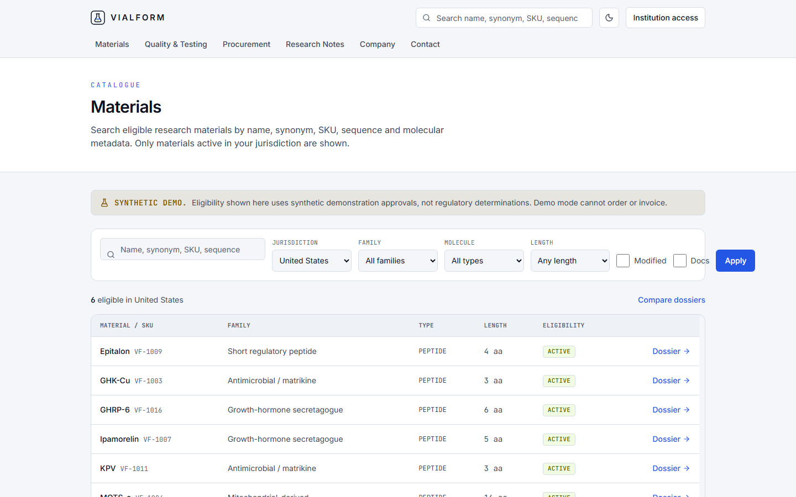
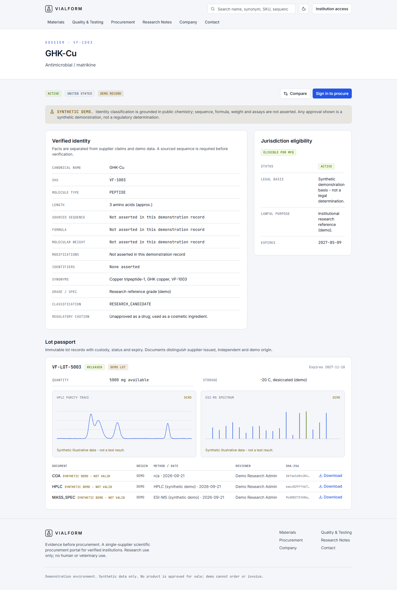
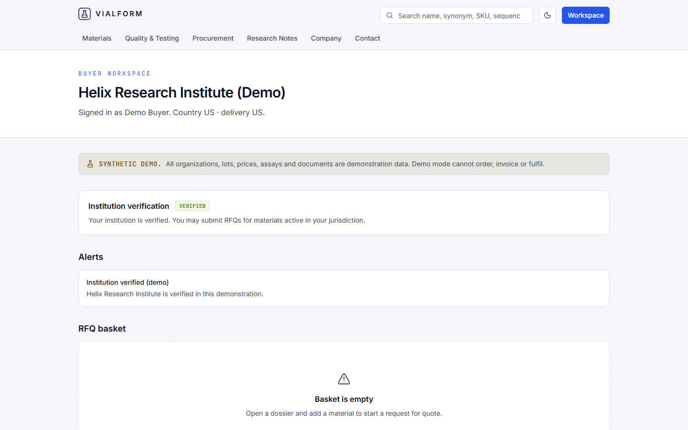
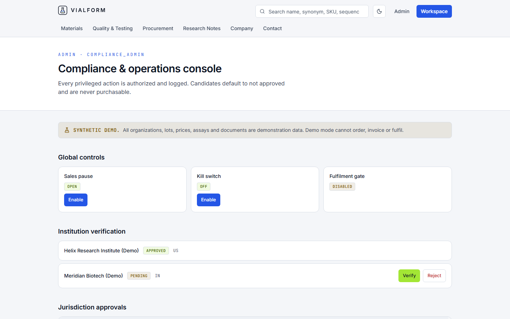

# VIALFORM

Evidence before procurement. A single-supplier B2B portal for peptide research
procurement by verified institutions. Identity, analytical evidence, provenance,
lot and jurisdiction eligibility are established before any request for quote.

[](https://vialform.vercel.app)
[](https://github.com/devtechedge/vialform/actions/workflows/ci.yml)


## Live Demo

https://vialform.vercel.app

> Demonstration environment. All organizations, lots, prices, assays, documents
> and approvals are synthetic and clearly labelled. The demo runs on embedded
> Postgres (PGLite) and resets on cold start. Demo mode cannot order, invoice,
> charge or fulfil. No product is approved for sale; research-use-only wording is
> not a determination of legality.

Demo accounts (synthetic, demo mode only): `buyer@helix.demo`,
`admin@vialform.demo`, `research@vialform.demo` with password
`Vialform-Demo-2026!`.

## Screenshots

| Catalogue | Dossier |
| --- | --- |
|  |  |

| Buyer workspace | Admin console |
| --- | --- |
|  |  |

## What it does

- **Jurisdiction-gated catalogue.** Server search over name, synonym, SKU,
  sequence and molecular metadata. Public users see only materials active in
  their jurisdiction; the watchlist stays private.
- **Scientific dossier.** Verified identity separated from supplier claims and
  demo data; sourced sequence required before verification; lot passport with
  custody, status and expiry.
- **Analytical evidence.** HPLC and mass-spec plots only from source data; demo
  plots say "synthetic illustrative data - not a test result". COAs are versioned,
  SHA-256 verified and served through private expiring downloads.
- **Compare.** Up to four dossiers side by side with missing fields exposed.
- **Institution access.** Accounts, organization, verification docs and status,
  teams and roles. No production demo password or role switcher.
- **Procurement.** Saved list to RFQ basket to eligibility check to request to
  review to immutable quote to PO to order to shipment milestones. No card
  payment in v1.
- **Compliance.** Server-side lifecycle (discovery to active) with legal-basis
  gating, expiry alerts, kill switch and global sales pause. Every privileged
  action is authorized and logged.

## Stack

| Layer | Choice |
| --- | --- |
| Framework | Next.js 16 App Router, React 19, strict TypeScript |
| Styling | Tailwind CSS 4, precision-instrument design tokens |
| Database | PostgreSQL via Drizzle ORM; PGLite demo, node-postgres production |
| Validation | Zod |
| Auth | Database-backed sessions, scrypt, HttpOnly SameSite cookies, RBAC |
| Tests | Vitest unit + PGLite integration, Playwright e2e with axe |
| Hosting | Vercel |

## Quick start

```bash
pnpm install
cp .env.example .env   # placeholders only; demo needs no real secrets
pnpm dev
```

The demo backend auto-seeds synthetic data on boot. Checks:

```bash
pnpm lint && pnpm typecheck
pnpm test && pnpm test:integration
pnpm build && pnpm e2e
```

## Deployment

See [docs/DEPLOYMENT.md](docs/DEPLOYMENT.md). Set `DATABASE_URL` for a managed
Postgres; apply migrations with `pnpm db:migrate`. The seed refuses production
non-demo runs.

## Safety and provenance

This is a lawful institution-facing research / analytical-reference workflow. It
does not promote human or veterinary use, dosing or therapeutic claims. Approved
medicines and prescription compounds are excluded from RUO sale. Regulatory
references and their uncertainty are recorded in
[docs/REGULATORY.md](docs/REGULATORY.md); the threat model is in
[SECURITY.md](SECURITY.md). Candidate identities are grounded in public chemistry;
sequences, assays and approvals are never fabricated.

## License

MIT. See [LICENSE](LICENSE).